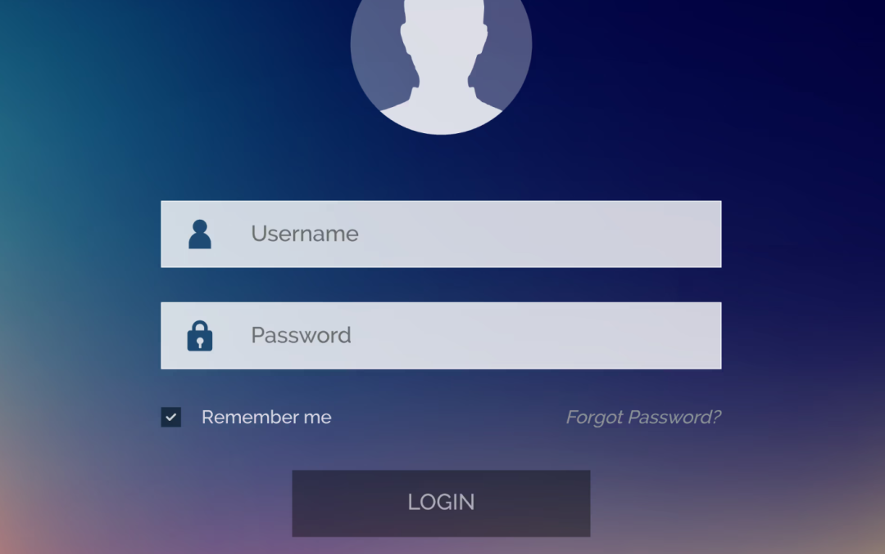

---

# 多账号统一登录 (实现方案)

> **来源:** [微信公众号《我是程序汪》](https://mp.weixin.qq.com/s/RhFWYdYobD2b7S29FNVdYg) · **作者:** jruing / [dustyblog.cn](https://www.dustyblog.cn) · **发布日期:** 2026-10-20 10:29 (BJ)
> **本仓库沉淀:** `ai-vibecoding-agents/multiAccountUnifiedAuth.md`(2026-10-20)

---

## 原文插图



> 公众号原文首图的视觉提示:本节主题是"账号登录",图中表单作为引子,正文沿此展开多账号统一登录的方案演进。

---

## 摘要

公众号《我是程序汪》2026-10-20 推文,作者 jruing(dustyblog.cn 博主)。**核心命题:** 把 `users`(用户基础信息)和 `user_auth`(登录授权方式)拆成两张表,使新增第三方登录(微信/QQ/微博/网易/手机号)的开发成本降到接近零;同时支持"同一种登录方式可以绑定多条"的扩展能力。

**核心数据结构:**

```sql
-- 用户基础信息表 — 只放昵称 / 头像等展示属性,不放任何凭证
users(id, nickname, avatar, more)

-- 用户授权信息表 — 一对多(同一用户可绑定多种登录方式)
user_auth(
id,
user_id,
identity_type,   -- phone / email / weixin / weibo / qq / netease / ...
identifier,      -- 手机号 / 邮箱 / 第三方唯一 id(openId 等)
credential,      -- 密码 hash(自建)或 token(第三方)
verified,        -- 统一校验位(替代 phone_verified/email_verified 等)
last_login_at,   -- 跟踪使用习惯("微博登录已经 N 天没用了")
last_login_ip
)
```

**4 阶段叙述:**

1. **自建登录体系** — 手机号+密码 → 手机号+验证码 → 第三方接入(噩梦来临)
2. **优化账号体系** — 把 user 与 auth 拆成两张表(本文核心 + 唯一新增动作)
3. **一键登录** — 运营商本机号码认证(2026 演化方向,中国 mobile/unicom/telecom 提供 API)
4. **小结** — 不写代码,只梳理思路

---

## 目录(原文目录)

- **一、自建的登陆体系**
- **二、优化账号体系**
- **三、一键登陆**
- **四、小结**

- 1.2 引入第三方账户方案
- 2.1 原账号体系分析
- 2.2 新的账号体系
- 3.1 背景
- 3.2 本机号码认证

- 1.2.1 微博登录
- 1.2.2 噩梦来临
- 1.1.1 手机号登陆注册
- 1.1.2 优化注册登陆
- 2.2.1 数据表设计
- 2.2.2 登录流程
- 2.2.3 优缺点

---

## 正文

现在几乎大部分的 App 都支持使用多个第三方账号进行登录，如：微信、QQ、微博等，我们把此称为多账号统一登陆。而这些账号的表设计，流程设计至关重要，不然后续扩展性贼差。

本文不提供任何代码实操，但是梳理一下博主根据我司账号模块的设计，提供思路，仅供参考。

## 一、自建的登陆体系1.1.1 手机号登陆注册 “该设计的思路是每个手机号对应一个用户，手机号为必填项。

流程：

首先输入手机号，然后发送到服务端。先判断该手机号是否存在账号，如果没有，就会生成随机验证码，将手机号和验证码绑定到 Redis 中，并设置一定的过期时间（过期时间一般是 5 分钟，这就是我们一般手机验证码的有效期），最后将验证码通过短信发送给用户。

用户接收到验证码后，在界面填写验证码以及密码等基础信息，然后将这些数据发送服务端。服务端收到后，先判断在 Redis 里面这个手机号对应的验证码是否一致，失败就返回错误码，成功就给用户创建一个账号和保存密码。

注册成功后，用户即可通过自己的 手机号+密码 进行登陆。

问题：

用户体验差，需要完成获取验证码，填写验证码/密码/用户名等诸多的信息完成注册，然后才能使用；

容易遗忘密码，遗忘后，只能通过忘记密码来重新设置密码。

#### 1.1.2 优化注册登陆 “该方案的思路是弱化密码的必填性，即无论用户是否注册过，可通过 手机号+验证码 直接进行登陆（保留 手机号+密码 登录的方式）。

流程：

输入手机号，然后发送到服务端。服务端生成随机验证码，将手机号和验证码绑定到 Redis 中，并设置一定的过期时间（过期时间一般是 5 分钟，这就是我们一般手机验证码的有效期），最后将验证码通过短信发送给用户。

用户接收到验证码后，在界面只需填写收到的验证码，提交到服务端。服务端收到后，先判断在 Redis 里面这个手机号对应的验证码是否一致，失败就返回错误码，成功就直接登录。如果是老用户，直接拉取用户信息；如果是新用户，则提示他可以完善用户信息（不强制）。

用户通过 手机号+验证码 登录后，也可选择设置密码，然后就可以通过 手机号+密码 的方式登录，即：密码是非必填项。

用户表设计：

id

user_name

user_password

user_mobile

state

more

用户 id

用户名

用户密码

手机号码

账号状态

其他信息

### 1.2 引入第三方账户方案 1.2.1 微博登录 进入 Web2.0 时代，微博开放了第三方网站登录，产品说，这个我们得要，加个用微博帐号就能登录我们的 App 吧，而且得和我们自己的用户表关联。

流程：

客户端调用微博登录的界面，进行输入用户名、密码，登录成功后，会返回 access_token，通过 access_token 调取 API 接口获取用户信息。

服务端通过用户信息在我们用户表创建一个账号，以后，该第三方账号即可通过该微博账号直接进行登陆。

微博用户信息表设计：

id

user_id

uid

access_token

主键 id

用户 id

微博唯一 id

授权码

#### 1.2.2 噩梦来临 紧接着，QQ 又开放用户登录了，微信开放用户登录了，网易开发用户登录了。。。。。。一下子要接入好多家第三方登录了，只能按照“微博用户信息表”新建一个表，重写一套各个第三方登录。

## 二、优化账号体系2.1 原账号体系分析 自建登陆体系：无论 手机号+密码，还是 手机号+验证码，都是一种 用户信息+密码 的验证形式；

第三方登录：也是 用户信息+密码 的形式，用户信息即第三方系统中的 ID（第三方系统中的唯一标识），密码即 access_token，只不过是一种有使用时效定期修改的密码。

### 2.2 新的账号体系 2.2.1 数据表设计 用户基础信息表：

id

nickname

avatar

more

用户 id

昵称

头像

其他信息

用户授权信息表：

id

user_id

identity_type

identifier

credential

主键 id

用户 id

登录类型(手机号/邮箱) 或第三方应用名称 (微信/微博等)

手机号/邮箱/第三方的唯一标识

密码凭证 (自建账号的保存密码, 第三方的保存 token)

说明：

用户表分为 用户基础信息表 + 用户授权信息表；

用户信息表不保存任何密码，不保存任何登录信息（如用户名，手机号，邮箱），只留有昵称、头像等基础信息；所有和授权相关，都放在用户信息授权表，用户信息表和用户授权表是一对多的关系 。

#### 2.2.2 登录流程 手机号+验证码

沿用之前的方案。

邮箱/手机号+密码

用户填写 邮箱/手机号+密码；请求登录的时候，先判断类型，如手机号登录为例：

使用 type='phone' 结合 identifier='手机号' 查找，如有，取出并判断 password_hash（密码）是否和该条目的 credential 相符，相符则通过验证，随后通过 user_id 获取用户信息；

第三方登录，如微信登录

查询 type='weixin' 结合 identifier='微信 openId'，如果有记录，则直接登录成功，并更新 token；假设与微信服务器通信不被劫持的情况下无需判断凭证问题。

#### 2.2.3 优缺点 优点：

登录类型无限扩展，新增登录类型的开发成本显著降低；

原来条件下，应用需要验证手机号是否已验证和邮箱是否已验证，需要相对应多一个字段如 phone_verified 和 email_verified，如今只要在 用户授权信息表 表中增加一个统一的 verified 字段，每种登录方式都可以直观看到是否已验证情况；

在 用户授权信息表 添加相应的时间和 IP 地址，就可以更加完整地跟踪用户的使用习惯，比如：已经不使用微博登录两年多，已经绑定微信 300 天；

如果你说邮箱和手机号就是用户信息的组成部分，users 表尽管拓展，users 表里依然有 email、phone，但他们仅仅作为“展示用途”，和昵称、头像或者性别这些属性没有本质区别；

可按需绑定任意数量的同类型登录方式，即一个用户可以绑定多个微信，可以有多个邮箱，可以有多个手机号。当然你也可以限制一种登录方式只有一条记录；

缺点：

用户同时存在邮箱、用户名、手机号等多种站内登录方式时，改密码时必须一起改，否则就变成了 邮箱+新密码、手机号+旧密码 都可以登录，肯定是很诡异的情况；

代码量增加了，有些情况下逻辑判断增加了，难度增大了；举个例子，无论用户是否已登录，无论用户是否已注册过，都是点击同一链接前往微博第三方授权后返回，可能出现几种情况：

该微博在本站未注册过，很好，直接给他注册关联并登录；

该微博已经在本站存在，当前用户未登录，直接登录成功；

该微博未在本站注册，但当前用户已经登录并关联的是另一个微博帐号，作何处理取决于是否允许绑定多个微博帐号；

该微博未在本站注册过，当前用户已登录，尝试进行绑定操作；

该微博已经注册，用户又已使用该帐号登录，为何他重复绑定自己；

该微博已经在本站存在，但当前用户已经登录并关联的是另一个微博帐号，作何处理？

## 三、一键登陆3.1 背景 回顾一下 手机号+验证码 的登录方式：

输入手机号、等待验证码短信、输入验证码、点击登录。整个流程走完可能需要 20 秒以上，操作也比较繁琐；

它是依赖短信网络的，因为如果收不到短信，也就登录不了了；

从安全角度考虑，还存在验证码泄漏的风险。如果有人知道了你的手机号，并且窃取到了验证码，那他也能登录你的账号了。

但回过头来想一下，为什么我们需要验证码？验证码的作用就是确定这个手机号是你的，那除了使用短信，是否还有别的方式对手机号进行认证？

如果能获取到当前使用的手机号，就能对用户输入的号码进行验证了。但出于安全考虑，客户端是无法直接获取到手机号的，运营商则可以通过 SIM 卡数据查询到。

现在运营商已经开放了相关的能力，我们可以在用户输入手机号后，通过调用运营商的接口，判断用户输入的手机号是否和本地号码一致。这样一来，用户就省去了等待验证码短信、输入验证码的过程，也不受短信网络的限制，简化了登录流程。

但再进一步想，如果运营商可以把当前的号码直接返回给我们，而不只是用于验证，那用户连手机号都不需要填了。

这就是该部分的主角：一键登录 。

### 3.2 本机号码认证 获取到当前手机使用的手机卡号，直接使用这个号码进行登录，这就是一键登录。

这种登录方式的好处是显而易见的。它可以更方便、快捷地完成注册、登录流程，将原本可能需要 20 秒的流程，缩短到了 2 秒左右，很大程度上提升了登录的用户体验。

主要步骤如下：

SDK 初始化：调用 SDK 的初始化方法，传入项目在平台上的 AppKey 和 AppSecret。

唤起授权页：调用 SDK 唤起授权接口。SDK 会先向运营商发起获取手机号验码的请求，请求成功后跳转到授权页。授权页会显示手机号掩码以及运营商协议给用户确认。

同意授权并登录：用户同意相关协议，点击授权页面的登录按钮，SDK 会请求本次取号的 token，请求成功后将 token 返回给客户端。

取号：将获取到的 token 发送到我们自己的服务器，由服务器携带 token 调用运营商一键登录的接口，调用成功就返回手机号码了。服务器用手机号进行登录或注册操作，返回操作结果给客户端，完成一键登录。

目前阿里云已经提供了该方式并可兼容三大运营商的号码，详见阿里云 SDK：

https://help.aliyun.com/document_detail/121113.html

var first_sceen__time = (+new Date()); if ("" == 1 && document.getElementById('js_content')) { document.getElementById('js_content').addEventListener("selectstart",function(e){ e.preventDefault(); }); } if ("0" == 1) { document.addEventListener("keydown",function(e){ if ((e.metaKey || e.ctrlKey) && (e.key === 'c' || e.key === 'C' || e.key === 'x' || e.key === 'X' || e.key === 'a' || e.key === 'A')) { if (e.target.tagName === 'INPUT' || e.target.tagName === 'TEXTAREA') { return; } e.preventDefault(); } }); document.addEventListener("copy",function(e){ var sel = window.getSelection(); var content = document.getElementById('js_content'); if (sel && sel.rangeCount > 0 && content && content.contains(sel.getRangeAt(0).commonAncestorContainer)) { e.preventDefault(); } }); } 预览时标签不可点 不喜欢 微信
微信扫一扫可打开此内容， 使用完整服务

<div

---

## 方法论备注(沉淀过程)

| 步骤 | 工具 | 输出 |
|---|---|---|
| 抓 HTML | `curl -A Chrome UA --Referer https://mp.weixin.qq.com/` | `page.html` (3.7 MB) |
| 提取元数据 | regex `msg_title / create_time / appmsgid / user_name` | 标题 / 发布日期 / GH ID |
| 提取正文 | `<div id="js_content">` 配 div 计数 → 块级扫描 | `article-body.md` |
| 下载图片 | `curl mmbiz.qpic.cn/...` referer mp.weixin.qq.com | 2 张 png |
| 验证图片 | vision_analyze(本地 MiniMax-M3) | 02-end.png = 作者头像 |
| 推送 | `git fetch origin/main` + `git update-ref` + rebase + push | commit 进入 `ai-vibecoding-agents/` |

**诚实点:**

- 目录区原文中"中国一部分。" 之类的章节题注被微信 H5 切得不太规整,我们用 intro_pos(`现在几乎大部分的`出现位置)之前的章节收集成 TOC;同一篇文章同时出现在目录中又出现在正文中。
- 表格识别被刻意跳过(本文无强结构化数据表,即便有微信原文也没有 `<table>` 标签)。
- 公众号"喜欢 / 在看" / 评论这类需要 cookie 认证的指标,**没法 curl 拿到** — 本沉淀不含这些数据。

---

## 参考

- [微信公众号原文: 《我是程序汪》 / 2026-10-20](https://mp.weixin.qq.com/s/RhFWYdYobD2b7S29FNVdYg)
- 同期姊妹文: dustyblog.cn 博客([jruing 个人博客](https://www.dustyblog.cn))
