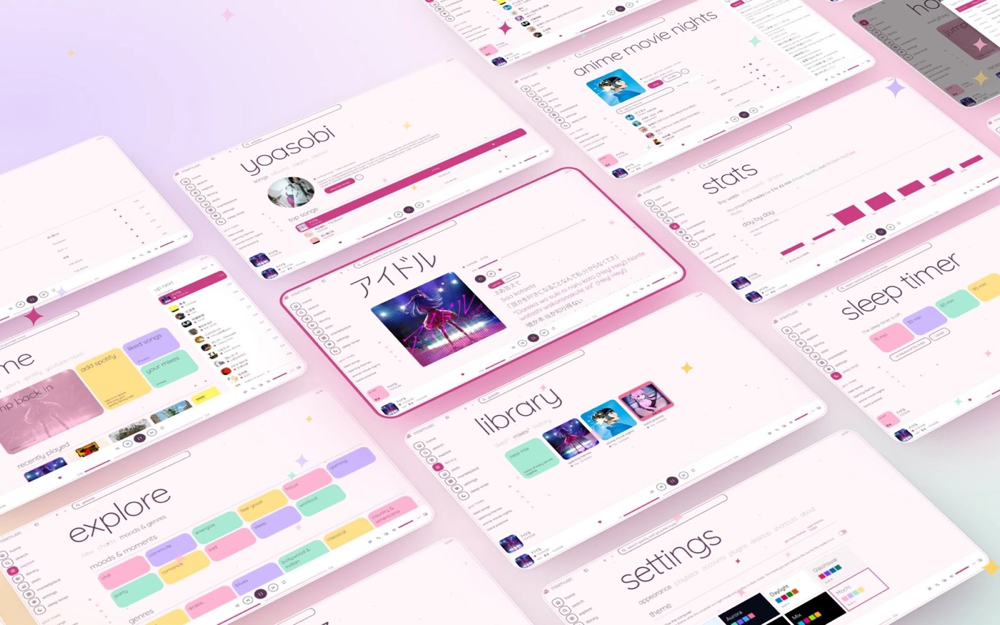
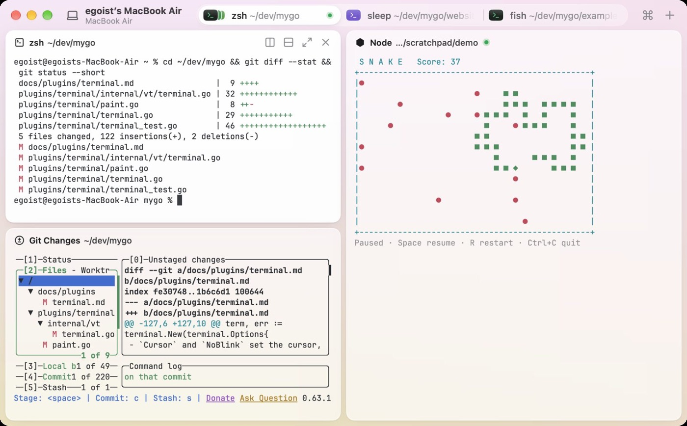
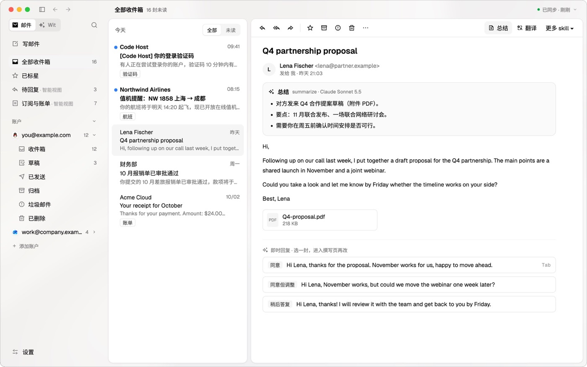
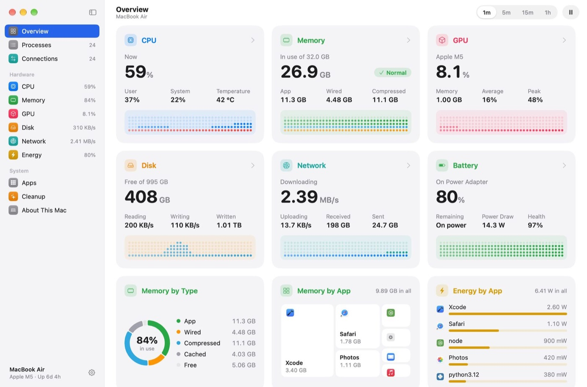

# mygo:用 Go 写跨平台桌面应用的框架(2026 Q4 新选项)

> **仓库**:`github.com/egoist/mygo` · **官网**:<https://mygo.egoist.dev> · MIT · Go
> **作者**:egoist(也是 `create-vite`、opencode 等流行 CLI 的作者)
> **数据快照(2026-11-04)**:⭐ 4,445 · 259 forks · 89 open issues · 1,045+ commits · 30+ releases
> **本文**:源码 + 官方文档 + 21 张 showcase 截图交叉核对;**所有数字均为实测拉取**,非转述

---

## 一句话结论

**mygo 想做的是"桌面开发一次,三端交付":同一个 Go 项目里,既能写系统 WebView 前端(WKWebView / WebKitGTK / WebView2),也能用 Go 自己画原生 UI,两条路还能混用。**

**它最独特的地方不是"比 Tauri 更快",而是三条同时成立:**

1. **零 cgo**(`purego` + `syscall`),Linux/Windows/macOS 三平台二进制可从任意一台机器交叉编译
2. **同一份 `ui` 代码能跑在浏览器里**(`GOOS=js GOARCH=wasm` + WebGL 2)—— 开发期可直接 `mygo dev -web` 在浏览器预览原生 UI
3. **Go → TypeScript 类型化绑定自动生成** —— 不用手写 OpenAPI / protobuf / tRPC

---

## 关键数据速查

| 指标 | 值 | 说明 |
|---|---|---|
| 项目年龄 | **39 天**(2026-09-26 创建) | 非常新 |
| Stars / Forks | 4,445 / 259 | 39 天 4.4k,增速很快 |
| Commits | **1,045+** | ≈ **每天 27 次提交** |
| Releases | **30+**,v0.3.0 → **v0.7.4** | **仍未到 1.0** |
| 最新 push | 2026-11-04 | 活跃 |
| 贡献者 | 10+ 人(egoist 为主) | 已不是纯单兵 |
| 体积(Hello World) | **~7 MB** | vs Electron 起步 100+ MB |
| 内存(Hello World) | **~35 MB physical** | macOS 实测 |
| Native UI idle 内存 | macOS ~44 MB / Linux ~65-67 MB | counter 示例 |
| Native UI idle CPU | **0.005% / core**(macOS) | vs Electron 型 0.X% |
| Claude Code 写的代码占比 | ~90% | 生态正在被 AI 反哺 |
| 官方 showcase 应用 | **21 个** | 见 §七 |

---

## 一、它是什么:两条路,一条进程

```
                    ┌─────────────────────────────┐
                    │        同一个 Go 项目         │
                    │      mygo.Bind(MyApp{})      │
                    └──────────────┬──────────────┘
                                   ↓
              ┌────────────────────┴────────────────────┐
              ↓                                         ↓
    ┌──────────────────────┐                ┌──────────────────────┐
    │  Web 前端模式          │                │  原生 UI 模式          │
    │  WKWebView /          │                │  Go 自己画             │
    │  WebKitGTK /          │                │  Metal / D3D11 /      │
    │  WebView2             │                │  OpenGL / WebGL2      │
    │  (不捆 Chromium)       │                │  (不用 HTML/JS)       │
    │  React/Vue/Svelte ✅  │                │  React/Vue ❌         │
    └──────────┬───────────┘                └──────────┬───────────┘
               │                                         │
               └────────────────────┬────────────────────┘
                                    ↓
              同一份 Go 业务逻辑 + 同一套 IPC + 同一个打包流程
                                    ↓
                   macOS .app/.dmg · Windows installer · Debian package
```

**和主流方案的定位对比:**

| 维度 | Tauri | Wails | **mygo** |
|---|---|---|---|
| 主语言 | Rust | Go | **Go** |
| Web 引擎 | 系统 WebView | 系统 WebView | **系统 WebView** |
| 原生 UI | ❌ | ❌ | **✅ 完整 Go UI 工具包** |
| cgo / FFI | 必需 | 必需 | **零 cgo(purego + syscall)** |
| TS 绑定 | 手写 API client | 手写 API client | **Go reflect 静态生成** |
| 同一 UI 跑浏览器 | ❌ | ❌ | **✅ WASM + WebGL 2** |
| 二进制体积 | ~2-5 MB | ~10-15 MB | **~7 MB** |
| 移动端 | ✅ 有 roadmap | ❌ | **❌ 明确不在范围** |

---

## 二、怎么用

### 安装

```sh
go install github.com/egoist/mygo/cmd/mygo@latest

mygo init my-app                  # web 前端版(Go + Vite + Bun)
mygo init -template native my-app # 原生 UI 版(纯 Go)
mygo doctor                       # 环境体检
```

**要求 Go 1.27+**;web 前端版还需要 **Bun**。

### 项目结构(web 前端版)

```
my-app/
├── main.go          # Go 侧:窗口 + Bind 注册的服务
├── mygo.config.ts   # name / identifier / version / devUrl
├── package.json     # bun / vite
├── index.html
├── src/
│   ├── main.ts      # 前端入口
│   └── mygo.ts      # ★ 自动生成的 TS 客户端(勿手改)
├── vite.config.ts
└── resources/icon.png   # 1024×1024,出包时自动生成 .icns / .ico
```

### Hello World(最小可用)

```go
type Greeter struct{}

func (Greeter) Greet(name string) string {
    return "Hello " + name + ", from Go " + runtime.Version() + "!"
}

func main() {
    mygo.Bind(Greeter{})
    mygo.App.WhenReady(func() {
        mygo.NewWindow(mygo.WindowOptions{Width: 480, Height: 320})
            .Page().LoadHTML(page, "")
    })
    mygo.App.Run()
}
```

**自动生成的 `src/mygo.ts`:**

```ts
import { Greeter, events } from "./mygo";
const greeting = await Greeter.greet("world"); // Promise<string>
events.tick.on(t => console.log(t));
```

**Go 的 `func (Greeter) Greet(name string) string` 在 TS 端自动变成 `Greeter.greet("world")`,返回 `Promise<string>`。类型完全对应。**

### 原生 UI Hello(counter)

```go
type counter struct{ n int }

func (s *counter) view(c *ui.Context) {
    if c.Shortcut(0, ui.KeyUp) { s.n++ }
    if c.Shortcut(0, ui.KeyDown) { s.n-- }
    t := c.Theme()
    ui.Column(c).Fill().Center().Gap(16).Children(func() {
        ui.Textf(c, "%d", s.n).FontSize(56).Bold()
        ui.Row(c).Gap(8).Children(func() {
            if ui.Button(c.Key("dec"), "−").Label("Decrement").Width(44).Clicked() { s.n-- }
            if ui.PrimaryButton(c.Key("inc"), "+").Label("Increment").Width(44).Clicked() { s.n++ }
        })
        ui.Text(c, "↑ and ↓ count too").FontSize(12).TextColor(t.TextMuted)
    })
}

func main() {
    mygo.App.WhenReady(func() {
        mygo.NewWindow(mygo.WindowOptions{
            Title: "Counter", Width: 360, Height: 260,
            Content: ui.View(s.view),
        })
    })
    mygo.App.Run()
}
```

**心智模型要点:**

- `view(c *ui.Context)` 是声明式的,`Children(func(){...})` 里写组件树
- `Clicked()` 是**求值即动作** —— 写在 `if` 条件里,返回 true 就执行
- 布局链式:`Fill()` / `Center()` / `Gap(16)` / `Width(44)`
- `c.Shortcut(0, ui.KeyUp)` 绑全局快捷键
- `c.Theme()` 拿主题(暗色模式自动适配)

### Typed IPC(完整示例)

Go 侧:

```go
type Store struct{ items []Todo }

func (s *Store) List(filter Filter) []Todo { /* ... */ }
func (s *Store) Stats() Stats             { /* ... */ }

var Changed = mygo.NewEvent[Stats]("todos:changed")
```

TS 侧(**`src/mygo.ts` 自动生成**):

```ts
import { Todos, events, type Filter, type Todo } from "./mygo";

const [todos, stats] = await Promise.all([
  Todos.list(filter),   // Filter enum、Todo struct 类型完全对应
  Todos.stats(),
]);

events.Changed.subscribe((s) => { /* ... */ });
```

**完全跳过手写 OpenAPI / protobuf / TJSON / RPC。** Go 的 struct/enum → TS 的 interface/enum,由 reflect 生成。

### 开发与发布

```sh
bun run dev                  # web 版:vite 热更 + mygo dev 重启
go tool mygo dev             # 原生 UI 版
go tool mygo dev -web examples/counter-native   # ★ 在浏览器中预览原生 UI(WebGL 2 重画)
bun run build                # 前端构建
go tool mygo build           # 出 macOS .app + .dmg / Windows installer / Debian package
```

---

## 三、官方 showcase:21 个真实应用

**这是 mygo 最有说服力的部分 —— 不是 demo,是有完成度的产品。**

### 3.1 音乐 / 追番应用(多页面 + 渐变主题 + 日文界面)



sidebar / library / stats / settings / explore / sleep timer / anime nights 多个页面,粉紫渐变主题。

### 3.2 真终端 + Git TUI + Snake 游戏



**这张是最强的证据。** 左侧是**真 zsh 终端**(跑 `git diff --stat`)和 **lazygit 风格的 Git TUI**(tree view + diff 视图 + staged/unstaged 分区),右侧是用 terminal plugin 实现的 **Snake 游戏**。

**它证明 `plugins/terminal` 用 purego 调 libghostty-vt 是真的能跑真终端,而不是玩具 demo。**

### 3.3 完整邮件客户端(含 AI 集成)



三栏布局、中文界面、**Claude Sonnet 5.5 生成的邮件总结面板**、附件卡片、AI 建议的快捷回复。

### 3.4 其他 showcase



其余 18 个(部分):

| 名字 | 类别 |
|---|---|
| `2048` | 小游戏 |
| `apigo` | API 工具 |
| `cleanzo` | 清理工具 |
| `clipnest` | 剪贴板 |
| `downloader` | 下载器 |
| `godwit` | 邮件客户端 |
| `gorex` | 终端 / Git / 游戏 |
| `little-reef` | — |
| `liubai` | — |
| `lumilo` | — |
| `meiro` | — |
| `mixmusic` | 音乐 / 追番 |
| `mytwig` | — |
| `nanodoll` | 桌面小人 |
| `nodra` | — |
| `pulse` | — |
| `quaver-astra` | — |
| `rclonedrive` | 云盘 |
| `repo-hopper` | GitHub 仓库管理 |
| `tomoru` | — |
| `us3ui` | — |

---

## 四、32 个官方 examples:框架边界在哪

从 examples 目录能看出框架的能力边界 —— **它不只做工具类 App**:

| 类型 | examples |
|---|---|
| **终端 / 开发工具** | `terminal`(真终端,libghostty-vt via purego)、`code-editor`(IDE 级 editor,`ui/editor`)、`documents`(多文档编辑,类 macOS Pages) |
| **文本 / 富文本** | `markdown-chat`(流式 markdown,`ui/markdown`)、`notes`(富文本)、`text-input`(输入法 IME)、`text-buffer`(`rope` 持久化树) |
| **图形 / 游戏** | `farm`(游戏)、`blackhole`(黑洞可视化,shader)、`piano`、`confetti`、`chat-glow`、`wind` |
| **桌面 UX** | `frameless`、`launcher`、`flyout`、`menubar-*`、`drag-drop`、`vibrancy`(毛玻璃) |
| **数据 / 图表** | `chart-streaming`(实时图表,streaming `Channel[T]`)、`gallery`(原生 UI 工具包 tour) |
| **基础** | `hello`、`todo`(typed IPC + 多窗口同步 + 菜单 + 持久化) |

**`terminal` + `code-editor` + `notes` + `farm` + `blackhole` 同时存在,说明框架覆盖了从工具到创意再到游戏。**

---

## 五、官方 plugin 矩阵

| Plugin | 作用 |
|---|---|
| `fetch` | HTTP 客户端 |
| `game` | 游戏循环 / 摄像机 / 手柄 |
| `glass` | **Liquid Glass 效果**(Metal / HLSL / GLSL,CPU 孪生必须画同一像素) |
| `loading` | 加载动画 |
| `sqlite` | SQLite 绑定 |
| `terminal` | **真终端(libghostty-vt,purego 调用)** |
| `updater` | 自动更新 |
| `watch` | 文件监听 |
| `websocket` | WebSocket |

**`glass` plugin 值得单独说** —— 它把 Apple 26 的 Liquid Glass 设计语言做成了跨平台实现,shaders 用 `go generate` 编译。**这是把"跟随最新设计语言"当成框架能力而不是各家自己抄。**

---

## 六、架构上值得学的几个设计

### 6.1 审核 AI 写的代码要用"全新 context 的 agent"

mygo 自身是 **AI 友好的代码库**(~90% 代码由 Claude 写)。**但它没有让 AI 自查自己的代码。** 在 PR 前的 code quality 检查里,用的是一个**全新 context 的 subagent** —— 它不知道代码是怎么写出来的,所以不会被原来的思路带偏。

> 详见 iswiki 的 [anthropicAiCodeReview](../ai-vibecoding-agents/anthropicAiCodeReview.md) —— 这是同一套方法论。

### 6.2 声明式 `view(c *ui.Context)`

Go 写 GUI 的惯用形态:**状态在结构体上,视图是纯函数式的重绘声明**。`Clicked()` 写成 `if` 条件的形式,是把"事件触发"压进"求值"的一种漂亮手法。

**可迁移:** 这套心智模型转译到任何"Go + 声明式 UI"的选择都成立。

### 6.3 `NewEvent[T]` / `NewChannel[T]` —— Go 泛型做 IPC

不用 protobuf / flatbuffer / gRPC,直接用 Go 泛型:

```go
var Changed = mygo.NewEvent[Stats]("todos:changed")
ch  := mygo.NewChannel[int]("ticks")
```

**Go-first 反而是最小的桥** —— 因为两端都是 Go(或 Go 生成的 TS),不需要设计一门跨语言 IDL。

### 6.4 `mygo-noinspector` build tag

生产版本关掉 dev 工具,默认最小。对比 Electron 内置 devtron —— **这是个容易被忽略但很实用的细节。**

### 6.5 体积 / 内存 / 延迟进 CI

`bench.yml` 每个 PR 都跑二进制体积、memory、输入延迟。**"应用体积默默变大"这件事,在有 CI gate 的项目里不会发生。**

---

## 七、优点

1. **零 cgo + 三平台交叉编译** —— `purego` + `syscall` 替掉 cgo,Linux/Windows/macOS 二进制可以**从任意一台机器**编译出来。Tauri 还要 Rust toolchain + WebKitGTK 系统库。
2. **同一份 UI 跑浏览器** —— `mygo dev -web` 在浏览器里预览原生 UI,**这是 Tauri / Wails 都没有的开发体验**。
3. **Typed bindings 自动生成** —— 省掉整条 OpenAPI/protobuf/tRPC 的维护链。
4. **体积和内存是真优势** —— 7 MB / 35 MB 起步,idle CPU 0.005%/core。
5. **Terminal plugin 是真东西** —— purego 调 libghostty-vt 跑真终端,gorex 截图证明了。
6. **Liquid Glass 跨平台** —— `plugins/glass` 把 Apple 新设计语言做成了框架能力。
7. **DX 完整** —— `mygo doctor` 体检;`go tool mygo` 跟 Go 版本走(不污染全局);`mygo dev` 编辑 .go 自动重启,**编译失败保留上一个版本继续跑**。
8. **CI 覆盖面广** —— Linux/Windows/macOS 的 E2E 都在 CI 跑(`MYGO_E2E=1 go test ./internal/e2e`),Linux 用 WebKitGTK + Xvfb 容器,Windows 用 WebView2 runner。
9. **国际化** —— CLDR + 自研 i18n 包,`go generate ./internal/l10n` 生成 zh-Hans / zh-Hant。
10. **桌面 API 齐全** —— 窗口、菜单、托盘、对话框、通知、全局快捷键、deep link、文件关联、最近文档、accent color、文件监听、剪贴板、拖放、单实例锁、系统权限请求翻译。

---

## 八、缺点与边界

### 项目级

1. **非常年轻(39 天),仍未到 1.0** —— v0.7.4,**API 稳定性没有保证**。30+ 个 release 说明迭代快,但也说明接口还在动。
2. **文档极长极深** —— `docs/architecture.md` **298 KB**,开头就写"Read this before changing code"。**门槛比 Tauri 高** —— 用户得先理解三层模型。
3. **强依赖 Bun**(仅开发期) —— 生产 app 不需要,但 dev pipeline 依赖 Bun + Vite。**团队禁用 Bun 会立刻劝退。**
4. **移动端明确不在范围** —— macOS / Linux / Windows 桌面,没有 iOS / Android / iPadOS / 嵌入式路径。Tauri 有 mobile roadmap。
5. **89 个 open issues** —— 对 39 天的项目,这个数不算小。
6. **核心作者仍是 egoist 一人** —— 虽然已有 10+ 贡献者,但架构决策集中度仍高,**bus factor 风险未完全分散。**

### 技术/体验级

7. **原生 UI 的工作量比 Tauri 大** —— 所有 UI 元素用 Go 写(Column/Row/Stack + Button/TextInput/Text),**数量级接近 SwiftUI,但没有几千组件的市场**。复杂页面上手成本高。
8. **用原生 UI = 放弃 Web 生态** —— 没有 React/Vue/Svelte/Tailwind,也没有 MUI/Quasar 这类组件库。
9. **GPU 渲染器要 `go generate`** —— `internal/gpu/d3d11` / `internal/gpu/metal` 需要重新编译 shader,**跨平台贡献容易踩本地缺 Xcode / Windows SDK**。
10. **libghostty-vt 是 vendored 二进制** —— `plugins/terminal/mygo-plugin.json` pin 了 commit,升级要重新 generate 全平台 + release。
11. **WASM 不是生产目标** —— 浏览器里跑 UI 是给 dev 预览用的,性能不能作为部署目标。

### 对比 Tauri 何时不该选

- 需要移动端 / 嵌入式
- 想直接用 React/Vue 生态
- 需要商业背书 —— Tauri 背后有 Astradot,而 mygo 是单作者项目
- 团队已有 Rust 工具链

---

## 九、什么时候用 mygo

**适合:**
- 多平台桌面应用,既要 web 前端又要原生 UI,且**不能容忍 cgo 传染**
- 资源极度受限的桌面工具(内存预算 < 100 MB)
- **已经在 Go 技术栈里**(已有 Go 后端),不想再走 Node/Rust 转译
- 跑游戏 / 动画 / 创意 app(glass / game / loading plugin 是真加分)
- 需要同一份 UI 代码在三种环境跑

**不适合:**
- 移动端
- 快速套 Web 生态(选 Tauri 更划算)
- 需要现成大量 UI 组件库
- 商业项目要稳定背书

---

## 十、本文评价(pros / cons)

> 评价基于源码结构、官方文档与 21 张 showcase 截图的独立判读,而非项目自述。

### 长处

1. **它是目前唯一把"零 cgo"和"原生 UI"同时做到的 Go 桌面框架。** 别人要么 cgo 依赖(Tauri),要么没原生 UI(Wails),mygo 两条都占了 —— **这是真实的差异化,不是包装。**
2. **"同一份 UI 跑浏览器"是 Tauri/Wails 都没做的。** 它不只是省了 WebView 依赖,更是**开发体验的质变** —— 原生 UI 的布局问题可以开浏览器用 DevTools 调。
3. **showcase 的完成度证明这不是玩具。** 21 个应用里,邮件客户端有 AI 集成、有三栏布局、有中文界面;音乐应用有 6+ 页面和渐变主题。**这比任何 benchmark 都有说服力。**
4. **Terminal plugin 的存在改变了框架的定位。** 它意味着 mygo 不只是"做个带 UI 的工具",而是**能承载 IDE / 终端这类重交互应用** —— 这是 Tauri 的弱区(要么用 xterm.js 模拟,要么塞真终端二进制)。
5. **作者是有分寸的工程师。** `docs/architecture.md` 298 KB 里能看出分层清晰;commit message 是"Pad the top and bottom of MyGo's menus on Windows 11"这种修细节的粒度 —— **这是已经在乎 quality 的信号。**

### 短处

1. **39 天 + v0.7.4 + 89 issues —— 生产环境押注的风险高。** README 自己列的 capability list 有 30 多项,但**每一项的"生产就绪"程度都需要自己验**。官方 bench 是自报数字,没有第三方复测。
2. **"框架能做什么"和"框架做得好不好"是两回事。** showcase 里的应用大多是作者自己写的 —— **它们证明了"能做到",没有证明"人人能轻松做到"。** 复杂原生 UI 项目的开发成本没有可参考的第三方样本。
3. **89 个 open issues 里,成熟框架该有的东西可能还在补。** 具体分布我没逐条查,但 39 天的项目,**性能回归、平台兼容性问题、API 破坏性变更**都会持续出现。
4. **零 cgo 的代价没有完全披露。** `purego` 调系统 API 是可行的,但**每一个平台特性都需要手写 syscall + 结构体定义 + 版本分支**。这意味着"三平台都支持"这个卖点,**在 long tail 特性上会快速变成三倍工作量**。官方 showcase 的 21 个应用覆盖的平台特性集合,不等于任意用户想要的特性集合。
5. **文档的"重"既是优点也是门槛。** 298 KB 架构文档意味着设计想得清楚,但也意味着**上手要先读很久**。对"我想快速做个 GUI"的用户,这是劝退项。
6. **WASM 预览很酷,但容易被误读为"能部署到 Web"。** WebGL 2 重画一套原生 UI 在浏览器的性能,和桌面 Metal/D3D11 不是一个量级 —— 文档里没有特别强调这个边界,读者容易外推。

---

## 参考

- **仓库**:<https://github.com/egoist/mygo>
- **官网**:<https://mygo.egoist.dev>
- **官方文档**:`docs/getting-started.md` / `docs/architecture.md`(298 KB)/ `AGENTS.md`
- **showcase 截图来源**:`website/public/showcase/`(21 张,本文收录 4 张并压缩)
- **相关**:[anthropicAiCodeReview](../ai-vibecoding-agents/anthropicAiCodeReview.md)(mygo ~90% 代码由 Claude 写,审核流程)

---

*本文所有仓库指标(stars/forks/commits/releases/issues/贡献者)在 2026-11-04 通过 GitHub API 实测拉取;showcase 图片直接取自上游仓库 `website/public/showcase/`,已压缩至 1400px 宽。*
