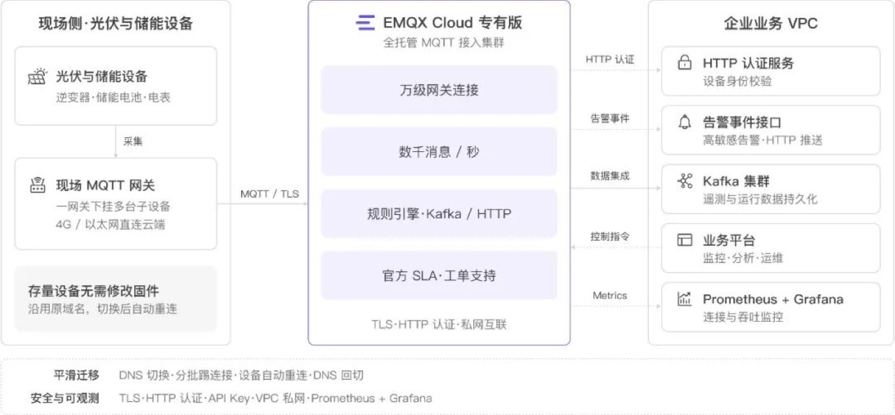

# EMQX Cloud 在光伏储能平台万级网关的落地:平滑迁移方案拆解

> **原文**:公众号《基于 EMQX Cloud 实现光伏储能平台万级网关平滑迁移》· EMQ 中文社区(EMQX 官方号)· 2026-11-12
> **原文链接**:<https://mp.weixin.qq.com/s/wQDgwYqRYSw38do3Rxw7cA>
> **场景**:某全球领先光伏逆变器与储能设备制造商(户用 / 工商业 / 地面电站),把自建开源 EMQX MQTT 接入层迁移到 **EMQX Cloud 专有版**
> **本文**:原文精读 + **官方文档与定价页交叉核对**(标注了原文未提、但对落地有决定性影响的事实)

---

## 一句话结论

**这是一次"不换域名、不改固件"的 MQTT 接入层替换:靠 DNS 切换 + REST API 分批踢连接把万级存量长连接从自建开源集群搬到 EMQX Cloud,靠规则引擎把「遥测走 Kafka、告警走 HTTP」拆成两条独立链路,靠 896 KB 批量上限 + HTTP 旁路绕开 Kafka 的 1 MB 硬限制。**

**真正可复用的不是 EMQX,是三个做法:**
1. **DNS 切换只影响新建连接** → 所以必须配"旧集群侧分批踢连接",两者缺一不可
2. **先生产者、后消费者** → 新数据先进新集群,旧消费者继续消费旧集群直到积压清零
3. **大报文走旁路、MQTT 只传元数据** → 从根上避免大包堵塞小包

---

## 关键数字速查

| 指标 | 值 | 出处 |
|---|---|---|
| 网关连接规模 | **万级** | 原文 |
| 单网关下挂设备 | 多台逆变器 / 储能电池 / 电表(4G 或以太网直连云端) | 原文架构图 |
| 峰值上行吞吐 | **数千条消息/秒**(部署规格按万级 TPS 规划) | 原文 |
| 生产报文特征 | KB 级为主 | 原文 |
| 控制指令 | 毫秒级,**QoS 1** | 原文 |
| 大报文 | 波形 / 日志文件**单包 > 1 MB** | 原文 |
| Kafka 单条消息上限 | **1 MB**(短期内无法升级) | 原文 |
| 重连建立速率上限 | **1000 连接/秒** | 原文 |
| EMQX 规则数上限 | 单部署最多 **50 条** | 原文(**未能从官方文档核实**,见 §八) |
| 扩容影响 | 15–25 分钟,期间 **2–3 次**短时连接中断 | 原文 |
| 写入成功率基线 | **99.99%** | 原文 |
| POC 环境规模 | 1000 线试用环境 → **20000 线** POC | 原文 |
| 免费试用 | **14 天** | 原文 ✅ 官方定价页证实 |
| SLA | **99.99%** + 24/7 支持 | 原文 ✅ 官方定价页证实 |
| **EMQX Kafka Max Batch Bytes 默认值** | **896 KB** | ⚠️ **官方文档,原文未提** |
| **专有版(Dedicated)起价** | **$0.32/小时 ≈ $234/月** | ⚠️ **官方定价页,原文完全未提** |

---

## 一、背景:为什么要迁

### 1.1 业务形态

该企业是全球领先的光伏逆变器与储能设备制造商,产品覆盖户用、工商业和地面电站。平台把**光伏逆变器、储能逆变器、储能电池、智能电表**统一接入云端,提供发电监测、组串级诊断、故障告警、远程参数配置。

早期基于**开源版 EMQX** 自建 MQTT 接入层,随着规模和单连接流量增长,暴露出**消息丢失、连接不稳定**。

### 1.2 行业特征决定了架构:网关汇聚

```
设备(逆变器/电池/电表)
        ↓  4G / 以太网
   现场 MQTT 网关          ← 一个网关下挂多台设备
        ↓  MQTT 长连接(公网)
     云端 MQTT 接入层
```

**这是降低联网成本的行业通用做法** —— 设备装 SIM 卡贵、流量贵,所以用网关汇聚。**代价是海量流量集中到少数网关**,对接入层的并发、吞吐和混合报文调度能力提出更高要求。

### 1.3 业务数据的两类时效要求

| 类型 | 要求 | 例子 |
|---|---|---|
| **常规遥测 / 运行数据** | 持续采集,供监控分析运维 | 发电量、充放电状态 |
| **高敏感告警** | **及时送达**,不能排队 | 离网、过温、电弧故障 |
| **下行控制指令** | **低时延** | 参数配置、固件升级、调度指令 |

⭐ **核心矛盾:高吞吐的大数据流不能拖累关键小报文的处理。** 后面「双通道集成」就是为这个设计的。

---

## 二、五个项目挑战(原文原话提炼)

### 挑战 1:上行链路环节多,消息可靠性难保障

**旧链路:**
```
设备 → 共享订阅分发 → 后端消费者 → 业务服务 → Kafka
```
环节多、排障链路长。**高峰时出现消息堆积超时、丢失,且难以定位丢在接入、分发还是写入环节。**

> ⭐ **这是最有价值的一条** —— 它不是"EMQX 不够好",而是**链路设计本身让故障不可定位**。新方案的核心就是**砍环节**。

### 挑战 2:网关汇聚下高并发与混合流量并存

万级网关连接,单网关下挂多台设备,峰值数千消息/秒。KB 级报文为主 + 毫秒级 QoS 1 控制指令 + >1MB 大报文,**三者并发时互相影响。**

### 挑战 3:Kafka 1 MB 限制增加集成难度

**Kafka 集群单条消息上限 1 MB,短期内无法升级。** EMQX 批量发送时若批次超 1 MB,Kafka 拒收报错,**这类错误不可重试,消息最终被丢弃**。

> ⚠️ **官方文档补充(原文未提)**:EMQX 的 `Max Batch Bytes` 默认值是 **896 KB**,**故意设在 1 MB 以下以留出 Kafka 消息编码开销**。而且文档明确:**"If a single message exceeds this limit, it will still be sent as a separate batch."**(超限单条会单独成批发送)
> → **所以"被丢弃"的责任在 Kafka broker 端(`message.max.bytes`),不是 EMQX 侧不做保护。** 原文把两者混在一起讲了。

### 挑战 4:存量长连接迁移要求业务连续性

**这是迁移的技术核心,四个子问题:**

| 子问题 | 原文的答案 |
|---|---|
| DNS 切换影响谁? | **只影响新建连接**,已建立的 TCP 连接仍在旧集群侧 |
| 旧连接怎么办? | 通过 **REST API 分批踢出** |
| 设备能自动回来吗? | 必须具备**自动重连能力** |
| 认证服务扛得住吗? | 重连风暴下连接建立速率**控制在 1000 连接/秒以内**,HTTP 认证服务要承压 |
| 会丢东西吗? | 迁移会**丢弃会话状态**,需评估**待重传消息和订阅关系**的影响 |

### 挑战 5:容量规划与后续运维

自建集群扩容要准备服务器和网络资源、容量评估、迁移窗口,运维投入大,**且没有原厂 SLA**。

迁到 EMQX Cloud 后扩容流程简化,但**扩容期间仍可能引发短时掉线和重连** —— 预计 **15–25 分钟、2–3 次短时中断**。

> ⭐ **原文给的对策**:项目缺少明确升级窗口,所以**上线前按目标规模一次性做完容量规划**,降低后续扩容对业务的影响。**这是把运维风险前置到 POC 阶段的做法。**

---

## 三、落地架构



**三栏结构:**

| 栏 | 内容 |
|---|---|
| **现场侧** | 光伏与储能设备(逆变器 / 储能电池 / 电表)→ 采集 → 现场 MQTT 网关(一网关下挂多台设备,4G / 以太网直连云端)<br>标注:**「存量设备无需修改固件,沿用原域名,切换后自动重连」** |
| **EMQX Cloud 专有版** | 全托管 MQTT 接入集群:万级网关连接 / 数千消息每秒 / 规则引擎·Kafka·HTTP / 官方 SLA·工单支持<br>底部标注:**「TLS·HTTP 认证·私网互联」** |
| **企业业务 VPC** | HTTP 认证服务(设备身份校验)/ 告警事件接口(高敏感告警·HTTP 推送)/ Kafka 集群(遥测与运行数据持久化)/ 业务平台(监控·分析·运维)/ Prometheus + Grafana(连接与吞吐监控) |

**连接关系:**
- 现场 → EMQX Cloud:**MQTT / TLS**
- EMQX Cloud → 业务 VPC:**HTTP 认证**(认证服务)、**告警事件**(HTTP 推送)、**数据集成**(Kafka)、**控制指令**(业务平台下发)、**Metrics**(Prometheus)

**底部横条(两条能力小结):**
- **平滑迁移**:DNS 切换 · 分批踢连接 · 设备自动重连 · DNS 回切
- **安全与可观测**:TLS·HTTP 认证 · API Key · VPC 私网 · Prometheus + Grafana

### 3.1 网络:私网为主,公网兜底

- **EMQX Cloud 通过 VPC Peering 与业务 VPC 打通**,Kafka 流量走私网
- **不占用公网带宽和时延波动**
- **公网 NAT 作为备用通道**

### 3.2 部署规格

**按万级连接 + 万级 TPS 规划**,相比当前数千条/秒峰值留足余量,为后续增长预留容量。

**专有版提供独立托管集群** —— 企业不必采购服务器、部署集群、承担版本升级和日常巡检。**官方 SLA + 工单支持。**

---

## 四、平滑迁移:五个步骤

### Step 1 — 用试用期把环境搭好(迁移前)

**先创建专有版部署,利用 14 天免费试用额度**,完成:

- HTTP 认证
- 主题重写
- 规则引擎
- Kafka 数据集成
- TLS 证书迁移

### Step 2 — 用测试域名 + 通配符证书验证 TLS 链路

### Step 3 — 分级 POC 验证

| 环境 | 验证内容 |
|---|---|
| **1000 线**试用环境 | 连接迁移 |
| **20000 线** POC 环境 | 按**稳态、峰值、大包、重连风暴**等场景验证 |

> ⭐ **注意验证矩阵的四个维度** —— 尤其"大包"和"重连风暴"这两个是迁移场景特有的,常规功能测试不会覆盖。

### Step 4 — 正式切换:DNS + 分批踢连接

```
① 提前下调 DNS TTL
② 业务域名 CNAME → EMQX Cloud 连接地址
   （DNS 切换不影响已建立的 TCP 连接）
③ 旧集群侧通过 REST API 分批踢出存量连接
   → 触发设备重新解析域名并连接新集群
④ 连接建立速率控制在 1000 连接/秒 以内
```

### Step 5 — 数据迁移:先生产者、后消费者

```
① 分批迁移网关设备 → 新数据流入 EMQX Cloud
② 保持后端消费者与旧集群的连接，直到积压消息消费完毕
③ 确认队列清零后，再切换消费者到新集群
```

### 回退路径

**DNS 回切 + 批量踢连接 → 触发设备回连旧集群。** 原文明确保留了这条可执行路径。

> ⭐ **回退能成立的前提是设备有自动重连能力** —— 这与挑战 4 是同一件事的两面。

---

## 五、数据集成:双通道设计

### 5.1 遥测走 Kafka

```
设备 → EMQX Cloud → 规则引擎(SQL:主题过滤 / 字段提取 / 路由) → Kafka 数据集成 → 下游集群
```

**设备上下线事件也通过规则引擎写入 Kafka。**

⭐ **核心收益:链路从"共享订阅分发 → 消费者 → 业务服务 → Kafka"四环节,简化为"规则引擎 → Kafka"两环节。** 这直接对应挑战 1 —— 环节少才能定位问题出在哪。

### 5.2 高敏感告警走 HTTP 直达

**离网、过温、电弧故障**等告警,通过规则引擎的 **HTTP 集成**直接推送到告警服务。

**只携带必要字段**:告警类型、设备标识、发生时间、关键测点。

⭐ **收益:告警链路不再经过高吞吐的数据队列** —— 缩短了从设备上报到运维触达的路径,**也避免告警在大流量时段排队**。

> 这就是挑战 2 里"大报文不能影响关键小报文"的解法:**不靠队列的优先级机制,而是物理分通道。**

### 5.3 大文件走 HTTP 旁路

**单条 > 1 MB 的波形和日志文件:**

```
文件上传 → HTTP 旁路直传对象存储
MQTT 链路只传输文件元数据和上传结果
```

⭐ **这不只是在"绕过 Kafka 1 MB 限制",更是在避免大包堵塞主链路。** 结合官方文档 —— EMQX 默认 896 KB 已留了编码开销,但**大文件根本不该走 MQTT**。

### 5.4 规则数配额的工程手法

**专有版单部署最多支持 50 条规则**,该企业把生产规则数量控制在配额以内,POC 中用 **20 条规则模拟多 Topic 转发**。

**需要更换 Topic 后重发的业务,用「主题重写」完成名称转换,减少规则数量占用。**

> ⭐ **这是配额约束下的通用解法** —— 用 Topic 重写把"改名字"从"加一条规则"降级为"配置一次重写"。

---

## 六、认证、安全与可观测

### 6.1 HTTP 外部认证 + 结果缓存

**EMQX Cloud 通过 POST 请求调用企业自有认证服务**做设备身份校验。

⭐ **关键配置:启用认证结果缓存,最大缓存条数 = 部署连接数** —— **确保外部认证服务不再是性能瓶颈**。

> 这直接对应挑战 4 的"重连风暴下认证服务要承压"。**缓存条数设成连接数,意味着重连风暴时认证服务几乎零压力。**
> ✅ 官方文档确认 EMQX HTTP 认证支持缓存机制。

### 6.2 安全

| 措施 | 作用 |
|---|---|
| **公网接入用 TLS 证书** | 加密设备连接 |
| **Kafka 流量走 VPC Peering 私网** | 不经过公网 |
| **API Key 最小权限分配** | 限制操作范围 |

### 6.3 可观测

- **EMQX Cloud 内置指标监控**
- **自建 Prometheus 采集**:集群连接数、吞吐、规则引擎、Kafka 集成指标
- 统一监控管理

---

## 七、项目成果

| 维度 | 结果 |
|---|---|
| **规模** | 稳定承载万级网关连接 + 数千条/秒峰值上行;万级 TPS 规格预留增长空间 |
| **迁移** | 设备零改造、迁移平稳完成;**迁移期间未发生因迁移导致的批量业务中断**;保留可执行回退路径 |
| **可靠性** | 核心遥测直接写入 Kafka,持续压测**写入成功率 99.99%**;原有共享订阅链路的丢失问题解决;敏感告警与大文件独立链路,降低流量互相影响 |
| **运维** | 不再自担服务器维护与版本升级;获得官方 SLA、工单支持、Prometheus/Grafana 能力 |

---

## 八、⚠️ 官方文档交叉核对:原文未提但影响落地的 4 点

> 本节是原文**没有写、但动手前必须知道**的事实,来源为 EMQX 官方文档与定价页(2026-11 核对)。

### 8.1 Kafka 批量的真实默认值是 896 KB,不是 1 MB

**原文说**:"EMQX 批量发送时,如果批次超过 1MB,Kafka 会拒收并报错,这类错误不可重试,消息最终被丢弃。"

**官方文档说**:
> **Max Batch Bytes (Sink)** — "The maximum size, in bytes, for collecting messages within a Kafka batch. Typically, Kafka brokers have a default batch size limit of 1 MB. **However, EMQX's default value is intentionally set slightly lower than 1 MB to account for Kafka message encoding overheads**... **If a single message exceeds this limit, it will still be sent as a separate batch.**"

**默认 = 896 KB。** 含义:
1. EMQX **默认就已经避开了** 1 MB 边界(留了编码开销)
2. **超限单条会单独成批**,不是直接丢弃 —— 真正拒收的是 Kafka broker(`message.max.bytes`)
3. 原文"不可重试、最终丢弃"的说法**把责任归错了层**

⭐ **落地动作:** 显式配置 `max_batch_bytes` 留足余量(别贴着 1 MB 设),并**监控单批实际字节数**;真正的硬限制在 broker 侧,应同时确认 broker 的 `message.max.bytes` 与 `replica.fetch.max.bytes`。

### 8.2 专有版有明确的成本起点,原文完全没提

**官方定价页(2026-11)**:

| 项 | 值 |
|---|---|
| Dedicated(专有版)起价 | **$0.32 / 小时 ≈ $234 / 月** |
| 计费基准 | Dedicated:**Reserved capacity**;Serverless:Session minutes + traffic + rule actions |
| 免费额度 | **14 天试用**;Serverless 免费层 1M session 分钟/月 + 1 GB 流量/月 |
| 包含 | 独立托管、VPC peering、**99.99% SLA**、24/7 支持 |
| 月度等效 | 按 730 小时;年付按 8,760 小时 |

⭐ **原文是官方营销案例,只讲收益不讲成本。** 落地前必须自己算:**万级连接 + 万级 TPS 的 Reserved capacity 一年多少钱**,对比自建集群的服务器 + 网络 + 人力总成本。

### 8.3 Buffer Mode 的持久性选项值得注意

**官方文档**(Kafka 数据集成):`Buffer Mode` 可选 `memory` / `disk` / `hybrid`。
- `memory`:**EMQX 节点重启时消息会丢**
- `disk`:**节点重启后仍可存活**
- `hybrid`:两者结合

> ⭐ **原文只说"写入成功率 99.99%",没提这个选项。** 对**告警链路**(尤其 HTTP 直达那条)来说,内存 buffer 在节点重启时丢消息是致命短板 —— **告警路径应该配 `disk` 或 `hybrid`**。

### 8.4 规则数 50 条上限未能核实

原文说"EMQX Cloud 专有版单部署最多支持 50 条规则",**我在 EMQX 官方文档与开源源码里都没找到这个常量**(可能由 EMQX Cloud 侧配额控制,非开源配置项)。

**建议:** 落地前直接向 EMQX 商务确认这个配额,以及**加规则时的审批/扩容路径**。

---

## 九、本文评价(pros / cons)

> 评价基于原文的论证质量 + 官方文档核对结果,而非观点倾向。

### 长处

1. **"先生产者、后消费者"是本文最可复用的工程顺序。** 很多人会直觉地先切消费者,导致新集群数据无人消费或旧集群数据被提前截断。**这个顺序把"数据不丢"和"切换平滑"同时满足了。**
2. **"DNS 切换只影响新建连接"这个事实被用作整个迁移方案的地基。** 它同时解释了为什么需要分批踢连接、为什么设备必须有自动重连、为什么回退路径成立。**一个事实串起三个设计决策,这是好方案的特征。**
3. **双通道设计(遥测走 Kafka / 告警走 HTTP)是"物理隔离优于队列优先级"的好范例。** 用两条链路彻底解决"大流量时告警排队",比在同一个队列里做优先级调度简单得多。
4. **大文件旁路把"绕过限制"做成了"根本不该走这条路"。** MQTT 只传元数据 + 上传结果,根上避免大包影响小包。
5. **认证缓存条数 = 部署连接数,这个配置很精确。** 它把"重连风暴时认证服务会不会被打挂"从概率问题变成了可计算问题。
6. **POC 验证矩阵包含"大包"和"重连风暴"** —— 这两个是迁移场景独有的,很多团队只测功能不测迁移态。
7. **保留了可执行的回退路径(DNS 回切 + 批量踢连接)**,而不是只说"做了灰度"。

### 短处

1. **⚠️ 通篇是官方营销案例,成本完全缺失。** 专有版起价 **$234/月**,年付与扩容单价都没提。**读者容易低估 TCO** —— 尤其原文把"扩容 15–25 分钟 + 2–3 次中断"说得像小事,但那是**业务连续性成本**。
2. **⚠️ 把 Kafka 拒收的责任归错了层。** 原文说"批次超 1MB → Kafka 拒收 → 不可重试 → 丢弃",但 EMQX 默认 **896 KB** 已避开边界,且**超限单条会单独成批**。真正的限制在 broker 端配置。**按原文理解去做配置,会配错位置。**
3. **⚠️ 没提 Buffer Mode 的持久性选项。** 告警链路走内存 buffer 时,EMQX 节点重启就丢消息 —— 对"及时送达"的告警是硬伤。原文的 99.99% 写入成功率掩盖了这个选择。
4. **没有失败案例。** 全程成功叙事,**没写踢连接过程中设备重连失败的处置、认证服务被打挂的应急预案、规则引擎写错导致数据错投的恢复**。实际迁移大概率遇到这些。
5. **没给出"迁移期间数据一致性"的验证方法。** 只说"队列清零后切消费者",但**怎么确认清零**、**清零前最后一批数据对不对得上**都没说。
6. **POC 环境的 20000 线是"模拟"还是真实设备?** 原文写"扩容到 20000 线 POC 环境按稳态、峰值、大包、重连风暴等场景验证" —— 若是压测模拟,真实设备的固件行为(重连退避策略、心跳间隔)可能对迁移影响更大。
7. **50 条规则上限的来源与扩容路径未说明** —— 官方文档与源码里都没找到这个常量,读者无法判断它是硬限制还是该客户的配额。
8. **"某企业"全程匿名。** 没有行业细节、没有设备型号、没有部署地域 —— **方法论可参考,但无法判断适用边界**(比如多区域、跨运营商、设备固件老旧等变数)。

---

## 参考

- **原文**:<https://mp.weixin.qq.com/s/wQDgwYqRYSw38do3Rxw7cA> — EMQ 中文社区,2026-11-12
- **EMQX Kafka 数据集成文档**(Max Batch Bytes 896 KB、Buffer Mode):<https://docs.emqx.com/en/emqx/latest/data-integration/data-bridge-kafka.html>
- **EMQX HTTP 认证文档**(认证缓存):<https://docs.emqx.com/en/emqx/latest/access-control/authn/http.html>
- **EMQX Cloud 定价页**(Dedicated $0.32/hr、99.99% SLA、14 天试用):<https://www.emqx.com/en/pricing>
- **EMQX 开源仓库**:<https://github.com/emqx/emqx>(16,930⭐,2026-11-22 仍在更新)

---

*本文基于原文 HTML 抓取(3.9 MB / 209 段 / 4 张图,仅架构图有信息量已收录)+ EMQX 官方文档与定价页交叉核对(2026-11)。§八 的 4 点为原文未覆盖、经核对补入的落地必需信息。*
